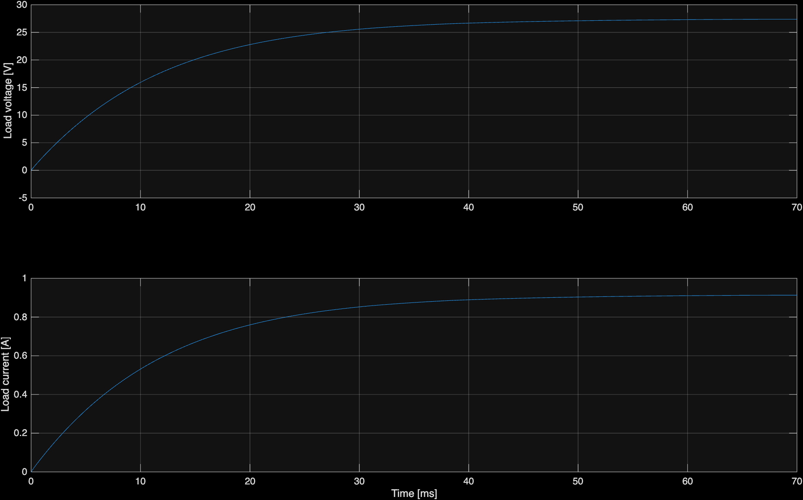

# DWPT model: operation, repairs, and usage

## What to open

`DWPT.slx` is the untouched original. `DWPT_fixed.slx` is the repaired, native Simscape version for the installed MATLAB R2026b. The original is a graphical Simulink circuit, not a standalone MATLAB algorithm. Its MATLAB code is an initialization callback that defines component values.

From this folder in MATLAB:

```matlab
open_system('DWPT_fixed')
[out, metrics] = run_dwpt();       % original simulation duration: 0.07 seconds
```

For a shorter startup run:

```matlab
[out, metrics] = run_dwpt(0.005);
```

Edit `dwpt_parameters.m` to change the defaults used by `run_dwpt`, or pass overrides:

```matlab
[out, metrics] = run_dwpt(0.07, struct('M2',40e-6));
```

The repaired SLX contains default values in its model workspace, so it can open and run without first populating the MATLAB base workspace. `run_dwpt` applies overrides for that simulation; it does not save them permanently into the SLX. To rebuild the saved defaults after editing the parameter function, run `repair_dwpt`. This starts from `converted/DWPT_simscape.slx` and overwrites only `DWPT_fixed.slx`.

Requirements: MATLAB, Simulink, Simscape, Simscape Electrical, and DSP System Toolbox (the inherited analog filter). Repair and simulation were performed with R2026b. Compatibility with older releases has not been established.

## Measured result

The repaired model completed 70 ms with a final-window mean load voltage of 27.38 V, load current of 0.913 A, load power of 24.99 W, and source power of 32.55 W. The corresponding window efficiency is 76.77%. These are simulation results for the inherited component values. See [the validation summary](validation/VALIDATION.md) for checks, averaging intervals, and limitations.



## The energy path

```text
                         transmitter 1: LT1, CT1, CP1, LP1
50 V DC -> two H-bridges <                                 > magnetic coupling
                         transmitter 2: LT2, CT2, CP2, LP2
    -> receiver coil LS -> series capacitor CS -> diode bridge
    -> 470 uF smoothing capacitor -> 30 ohm load
```

Both bridges share the DC supply and run at 85 kHz. They convert DC into alternating voltage. The compensation networks shape the currents and exchange reactive energy with the coils. Magnetic coupling induces a receiver voltage. The diode bridge rectifies it, and the output capacitor smooths the resulting DC.

The model contains no voltage regulator, battery model, vehicle-position input, speed input, or transmitter handover controller. It represents one fixed coupling condition. The name DWPT suggests dynamic wireless power transfer, but motion is not implemented here.

## The initialization values

MATLAB notation `437.3e-6` means 437.3 microhenries when used for inductance. Similarly, `9.03e-9` means 9.03 nanofarads.

| Symbol | Value | Meaning |
|---|---:|---|
| `f` | 85,000 Hz | Switching frequency |
| `Vdc` | 50 V | Shared DC supply |
| `LP1`, `LP2` | 437.3, 420.6 uH | Transmitter coil self-inductances |
| `LS` | 306 uH | Receiver coil self-inductance |
| `LT1`, `LT2` | 98, 99.5 uH | Input compensation inductors |
| `CP1`, `CP2` | 9.03, 9.23 nF | Series compensation capacitors |
| `CT1`, `CT2` | 55, 54 nF | Shunt compensation capacitors |
| `CS` | 12.5 nF | Receiver series capacitor |
| `M1`, `M2` | 94, 0 uH | Coupling from each transmitter to receiver |
| `RP1`, `RP2`, `RS` | 1.4, 1.4, 1.3 ohm | Coil winding resistances |
| `RL` | 30 ohm | DC load resistance |

The compensation inductors also have 0.1 ohm series resistance each. The output smoothing capacitor is 470 uF. MOSFET on-resistance is 0.09 ohm; their body-diode parameters are 3.3 V forward drop and 0.01 ohm conducting resistance. Rectifier diodes use 1.5 V and 0.03 ohm. These are inherited modeling assumptions, not verified component datasheets.

## How the H-bridges work

The upper and lower switches on a bridge leg must not conduct simultaneously. `S1` and `S4` drive one diagonal pair; `S2` and `S3` drive the other. The second bridge repeats the arrangement using `S5`–`S8`.

One diagonal applies approximately +50 V to the compensation circuit; the other applies approximately -50 V. Switch voltage drops and inductive freewheeling modify the actual waveform.

At 85 kHz:

- Period = 1/f = 11.7647 microseconds.
- Half-period = 5.88235 microseconds.
- Each pulse occupies 49.5% of the period = 5.82353 microseconds.
- The gap between opposite pulses is 0.5% of the period = 58.8235 nanoseconds.

The original electrical sample interval was 100 ns, longer than the intended dead time. Its callback separately set Ts = 10 ns, and the model used a variable-step solver, so the displayed fixed-step setting did not enforce that callback value on the electrical network.

The repaired model uses Simscape's local implicit trapezoidal solver for the electrical network, with a fixed step Ts = 1/(400*f) = 29.4118 ns. The global fixed-step `ode3` solver handles the continuous diagnostic/filter states. A switching period is exactly 400 steps, each on-pulse is 198 steps, and dead time is 2 steps. Doubling `samplesPerPeriod` halves the step and provides a numerical convergence check. This configuration was selected after adaptive-solver trials showed poor runtime and solver-dependent startup results; see the validation summary for the final convergence measurements.

## What the coupled-coil block calculates

For fixed inductances, the winding equations are:

```text
v1 = RP1*i1 + LP1*di1/dt + M1*is/dt
v2 = RP2*i2 + LP2*di2/dt + M2*is/dt
vs = RS*is  + M1*di1/dt + M2*di2/dt + LS*dis/dt
```

The signs depend on the winding terminal reference directions. The stored inductance matrix is:

```matlab
L = [LP1, 0,   M1;
     0,   LP2, M2;
     M1,  M2,  LS];
```

The zero between LP1 and LP2 assumes no direct magnetic coupling between transmitters. M1 and M2 connect them to the receiver. The matrix must be positive definite for a physically valid nonsingular stored-energy model: magnetic energy is `0.5*i.'*L*i`. The runner checks this before simulation.

The first coupling coefficient is `k1 = M1/sqrt(LP1*LS) = 0.257`. The second is zero. Therefore transmitter 2 can draw circulating current and dissipate power, but cannot magnetically supply the receiver in the default setup. It remains enabled to preserve the original operating case.

For zero transmitter-to-transmitter coupling, physical validity requires `M1^2/LP1 + M2^2/LP2 < LS`. Checking each individual coefficient against 1 alone is insufficient.

Actual motion would require a measured or calculated M1(x), M2(x), a position trajectory, and a suitable variable-inductance formulation. With time-varying L, voltage is `d(L*i)/dt`, which includes both `L*di/dt` and `(dL/dt)*i`. Simply changing a constant between independent simulations gives position snapshots, not a transient motion model.

## Compensation and tuning

Each transmitter has an LCC arrangement: an input series inductor LT, a shunt capacitor CT, and a series capacitor CP feeding its coil LP. The receiver has series compensation CS.

For one common ideal LCC tuning condition at angular frequency w = 2*pi*f:

```text
CT = 1/(w^2*LT)
CP = 1/(w^2*(LP - LT))
CS = 1/(w^2*LS)
```

At 85 kHz these give:

| Capacitor | Original | Ideal tuning comparison |
|---|---:|---:|
| CT1 | 55 nF | 35.775 nF |
| CT2 | 54 nF | 35.235 nF |
| CP1 | 9.03 nF | 10.333 nF |
| CP2 | 9.23 nF | 10.918 nF |
| CS | 12.5 nF | 11.457 nF |

This difference is not by itself proof of a defect. Detuning can be intentional, and losses, loading, coupling, desired soft switching, and component constraints affect the chosen operating point. The repair preserves the original capacitances. The isolated LS–CS resonance is about 81.38 kHz; the entire coupled, loaded network has a more complicated response than one LC resonance.

## Rectification and measurements

The receiver drives a full-wave diode bridge. The 470 uF capacitor supplies load current between charging intervals. Its load discharge time constant is approximately RL*Cd = 14.1 ms. This does not by itself establish the complete network settling time.

`Cd2` originally showed an initial-voltage entry of 100 V, but the enable flag was off. It therefore did not request a 100 V precharge. The repair does not introduce one.

Important measurement names:

| Signal/block | What it measures |
|---|---|
| `Idc` / new `dc_current` | Total current supplied to both inverters |
| `V M` / new `dc_voltage` | Shared DC supply voltage |
| `Io2` / original `Iin` | Transmitter 1 inverter output current |
| `Io1` / original `Ip` | Transmitter 1 current after LT1, before the CT1/CP1 split (not the coil-branch current) |
| `Io5` | Transmitter 2 inverter output current |
| `Is2` / original `Iout` | Receiver AC current, before rectification |
| `V M3` / original `Vout` | Receiver bridge AC-input voltage |
| `Io4` / new `load_current` | DC load current |
| `Uo2` / new `load_voltage` | DC load voltage |
| `V M5` / original `Vin` | Transmitter 1 inverter AC-output voltage |
| `V M1` / original `VnodeA` | Voltage across LT1, with its sensor polarity |

The old workspace names `Iout` and `Vout` describe AC-side signals, not DC load output. New explicit names prevent that ambiguity while retaining old outputs for compatibility.

RMS is `sqrt(average(x^2))`. It describes heating-equivalent current or voltage. Average and RMS differ whenever there is ripple or AC content.

Real power is `average(v(t)*i(t))`. The original output display calculated `average(i)*RMS(v)`, using unequal averaging windows. The repair multiplies instantaneous voltage and current first and then averages over 100 switching periods. The input display now follows the same rule. The original input product of separate means happens to be valid for an ideal constant-voltage source, but the corrected form also handles varying voltage.

The runner integrates using actual simulation timestamps (`trapz`). The default repaired model uses a uniform fixed step, but time-weighted integration also remains valid if the solver is later changed to variable-step. A plain `mean` of variable-step samples would over-weight periods where the solver took more steps. The final measurement window contains up to 100 complete switching periods and occupies at most roughly the final fifth of the run. These are window measurements, not automatic proof of steady state.

Load power can independently be checked as `average(vload^2)/RL`. Efficiency is `100*Pload/Pin`. Startup energy stored in capacitors and inductors must be considered before interpreting that ratio as steady-state efficiency.

The inherited eighth-order Butterworth low-pass filter has its cutoff at 85 kHz. A Butterworth response is approximately -3 dB at cutoff, so its RMS display is not an unattenuated fundamental-voltage measurement. This diagnostic filter is preserved and is not used for the corrected power calculation.

## Repair decisions

1. Converted deprecated SPS blocks to native Simscape; removed obsolete powergui.
2. Added separate voltage references for the source and galvanically isolated receiver. The automatic conversion left the receiver floating, which prevented transient initialization.
3. Replaced coupled-inductor conversion-helper expressions with direct LP, M, and R parameters. The generated helpers evaluated unused original variables Lf, Lt, and M that were undefined.
4. Set semiconductor parameters directly, retaining the original resistance and forward-drop assumptions and 100 kohm off-state/snubber conductance scale. Native piecewise-linear switch implementations are not an exact legacy switching-loss model.
5. Restored RMS frequency windows after the converter defaulted them to 60 Hz. Removed the inconsistent 120 V initial RMS estimate.
6. Corrected real-power calculations and made their averaging windows consistent.
7. Connected RL and Vdc parameters to the actual blocks; originally RL was defined but the load used a literal 30.
8. Replaced conflicting timing settings and misleading printed sample-count text with a documented solver configuration.
9. Removed unused empty gate-scope inputs; added explicit source/load logging.
10. Added a parameterized runner with input and inductance-matrix checks and time-weighted metrics.

The conversion gives native capacitors a tiny 1 microohm series resistance. This is numerical regularization, not a measured capacitor ESR. Physical losses, electromagnetic coupling geometry, thermal behavior, device switching transients, and hardware accuracy remain design-validation work. The old model cannot provide a trustworthy legacy baseline in the installed release because its library was removed.

## Files

- `DWPT.slx`: untouched source.
- `DWPT_fixed.slx`: repaired native model, with embedded default workspace values.
- `dwpt_parameters.m`: named circuit values and timing settings.
- `run_dwpt.m`: simulation, metrics, optional plots.
- `repair_dwpt.m`: reproducible repair of the automatic conversion.
- `converted/DWPT_simscape.slx`: intermediate MathWorks conversion, not the model to run.
- `validation/`: logs and numerical validation results; consult the validation summary for completed checks.

MathWorks references: [SPS migration](https://www.mathworks.com/help/sps/ug/upgrade-sps-models-to-use-simscape-blocks.html), [conversion assistant](https://www.mathworks.com/help/simscape-electrical/ref/spsconversionassistant.html).
