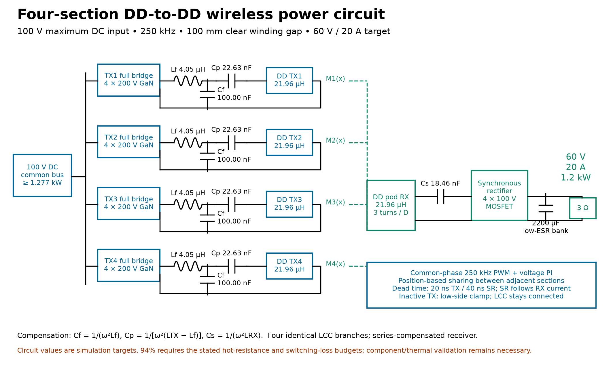

# Guadaloop wireless power transfer

MATLAB/Simulink models, coil calculations, simulation results and engineering reports for a four-section DD wireless power track.

## Current design

- Maximum DC input: **100 V**
- Output target: **60 V, 20 A, 1.2 kW**
- Frequency: **250 kHz**
- Clear winding gap: **100 mm**
- Track: **12 ft × 2 ft**, four 3 ft × 2 ft sections
- Receiver: one matching DD pad in a 3 ft × 2 ft envelope
- Compensation: four primary LCC branches and one series-compensated receiver
- Each complete DD pad: **21.958256 µH calculated**, three turns per D lobe
- Separate LCC inductors: **4.052847 µH**, four required

Start with [the design report](DD_TRACK_DESIGN.md) and [START_HERE](START_HERE.md). The current circuit is [DWPT_DD_4section_100V.slx](DWPT_DD_4section_100V.slx).



## Download and run

Download the complete package from the repository Releases page, use **Code → Download ZIP**, or clone this repository. Extract the complete folder before opening MATLAB; scripts and data must remain together.

The saved project was developed with MATLAB R2026b, Simulink and Simscape. Older MATLAB releases may require model export to a compatible release. MATLAB and its toolboxes are not included.

Set MATLAB's Current Folder to the extracted project folder and run:

```matlab
show_dd_track
```

To open only the circuit:

```matlab
open_system('DWPT_DD_4section_100V.slx')
```

To run a 50 ms test at the first section boundary or the verification suite:

```matlab
[metrics, waveforms] = run_dd_track(0.9144, 0.050, struct(), 'seam');
validate_dd_track
```

To rebuild the magnetic component and circuit:

```matlab
ssc_build('ddtrack');
build_dd_track;
validate_dd_track;
plot_dd_track;
```

The Python geometry tools require NumPy, SciPy and Matplotlib. Install them in your own Python environment with `python -m pip install -r requirements.txt`. See the design report for regeneration order.

## Included files

- Final and original `.slx` models, native Simscape component source, and MATLAB build/run/validation scripts.
- `design_dd_track/`: current coil calculations, coupling data, plots, numerical metrics and saved waveform MAT files.
- `design_dd_track/baseline_silicon/` and `design_dd_track/history/`: superseded exploratory results, retained for traceability.
- `design1200w/`, `design250k/`, `validation/`, and `converted/`: earlier designs and repair/validation artifacts.
- Engineering explanations and reports in the root Markdown files.

The earlier circular-coil models use different requirements and are not the final four-section DD design. Rebuildable MATLAB caches, Python caches and the locally installed Python dependency directory are excluded. Saved simulation results are included; the project is approximately 363 MB before packaging.

## What the tests establish

The tested nominal positions regulate near 60 V and 20 A with estimated efficiency of 95.01–95.44% under the documented assumptions. This is simulation evidence, not measured prototype performance or a fabrication release. The coils need measurement and capacitor trimming at 250 kHz. Both D lobes together form one 21.96 µH pad; the LCC inductors do not use that value.

The fully covered receiver-center travel region is 9 ft within the 12 ft track. The entrance-overhang case does not achieve rated output. Maximum speed remains unspecified, and moving-handover examples use a reduced model. Resonant voltage can reach approximately 1.48 kV despite the 100 V input; implementation ratings and remaining hardware work are documented in the report.

## Public availability

This repository and its release package are public and can be viewed or downloaded without an invitation. No separate reuse license has been selected. Included third-party datasheets retain their publishers' rights.
